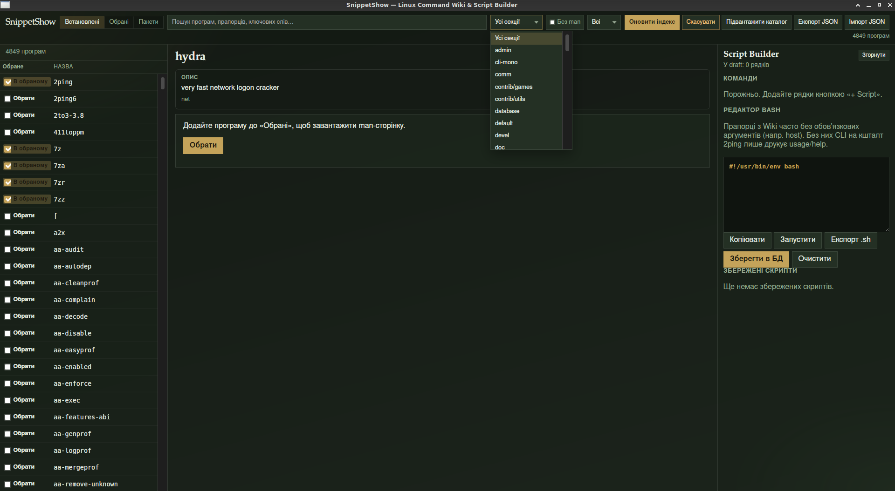

# SnippetShow

**SnippetShow** — локальна Linux-only десктопна утиліта (Wails v2): інтерактивна wiki CLI-команд, man-прапорців, користувацьких сніпетів і конструктор bash-скриптів.

| | |
|---|---|
| Стек | Go ≥ 1.22 (фактично `go.mod` 1.26.0 через Wails v2.17.1) · Wails v2 · Vanilla JS (Vite) · SQLite FTS5 (`modernc.org/sqlite`) |
| БД | `~/.local/share/linux-cmd-wiki/wiki.db` (**D1** / **D11** — без міграції шляху до публічного релізу) |
| Платформи | Debian/Ubuntu, Arch, Fedora — **лише Linux** |
| Ліцензія | [MIT](LICENSE) |

Канонічні docs: [`docs/DECISIONS.md`](docs/DECISIONS.md) (D1–D13) · [`docs/LIVING_SPEC.md`](docs/LIVING_SPEC.md) · [`docs/ROADMAP_FIXES.md`](docs/ROADMAP_FIXES.md) · [`docs/TODO_FIXME.md`](docs/TODO_FIXME.md) · [`docs/NFR_NOTES.md`](docs/NFR_NOTES.md).

## Можливості (стан `main`)

- Режими **Встановлені** / **Обрані** / **Пакети** + фільтр **«Без man»**; алфавіт і **Section** — custom dark toolbar-select (WebKitGTK).
- **Names-first** індекс: швидкий список імен PATH; Section/PM metadata збагачуються у фоні (також на warm bootstrap, якщо категорії порожні).
- **Man-gate (D13):** man парситься й зберігається лише для **Обраних**; «Обрати» / «В обраному» у навігаторі; зняття з обраного purge `man_commands`.
- Навігатор **name-first** (Обране + Назва); lead-опис у wiki для Обраних.
- Wiki: man-таблиця, Raw Man, install-hint для пакетів, завжди рядок **«Базова команда»**, CRUD «Мої команди», Copy / Run / + Script.
- **Script Builder:** reorder (↑↓ / DnD), bash editor, Copy / Run / Export `.sh` (+x) / Save у БД.
- JSON backup (`version: 1`) — лише `user_snippets` + `custom_scripts` (merge, ідемпотентний повторний імпорт).
- Safety confirm перед Run для `rm -rf` / `dd` / `mkfs` / `sudo` (і path/`env` wrappers).

<p align="center">
  
</p>

## Вимоги

- Go 1.22+
- Wails CLI v2: `go install github.com/wailsapp/wails/v2/cmd/wails@latest`
- Node.js + npm
- `gcc`, `pkg-config`, GTK3, webkit2gtk

### Залежності webkit2gtk

**Debian / Ubuntu** — [`build/dist-notes-ubuntu.md`](build/dist-notes-ubuntu.md)

```bash
sudo apt update
sudo apt install build-essential pkg-config libgtk-3-dev libwebkit2gtk-4.1-dev
```

Ubuntu 24.04+: збірка з tag `webkit2_41` (`./build/build.sh`).

**Arch** — [`build/dist-notes-arch.md`](build/dist-notes-arch.md)

```bash
sudo pacman -S base-devel gtk3 webkit2gtk
```

**Fedora** — [`build/dist-notes-fedora.md`](build/dist-notes-fedora.md)

```bash
sudo dnf install gtk3-devel webkit2gtk4.1-devel
```

## Розробка / тести

```bash
wails doctor
wails dev
./scripts/ci-local.sh   # unit + staticcheck (обов’язковий, pin 2026.2.2)
```

Проєкт тестується у контрольованому середовищі (venv / CI), не «на око» на прод-машині.

## Збірка ELF

```bash
./build/build.sh
# → build/bin/SnippetShow
```

Артефакти збірки **не в git**: `build/bin/`, `frontend/dist/` (окрім `.gitkeep`), `frontend/wailsjs/`, `*.AppImage`, coverage, smoke-логи — див. `.gitignore`. Каталоги `build/windows` / `build/darwin` навмисно відсутні.

## Dist smoke (v0.1 / D12)

```bash
./scripts/ubuntu-dist-smoke.sh
```

Ubuntu — обов’язковий чекліст (**checked**). Arch/Fedora — deferred / best-effort після базової готовності.

## Структура

```
internal/{app,db,scanner,manparser,index,clipboard,terminal,safety,backup,scriptbuilder}
frontend/src/ui/{toolbar,navigator,shell,wiki,builder}.js
docs/   scripts/ci-local.sh   .github/workflows/ci.yml   build/
```

## JSON backup

Toolbar **Експорт / Імпорт JSON**:

- Сніпети: ключ `(programName, title, command)`; дублікати пропускаються; відсутня програма → stub (`is_installed=0`).
- Скрипти: ключ `(name, scriptBody)`; дублікати пропускаються.
- Повторний імпорт ідемпотентний для ідентичних записів.

## Статус

MVP фази 0–4 + hotfix / UI polish через **SS-52** — на `main`. Черга Autopilot порожня: [`docs/ROADMAP_FIXES.md`](docs/ROADMAP_FIXES.md). NFR Idle RSS — **D9** accepted-deviation (webkit2gtk часто > 80 МБ).
